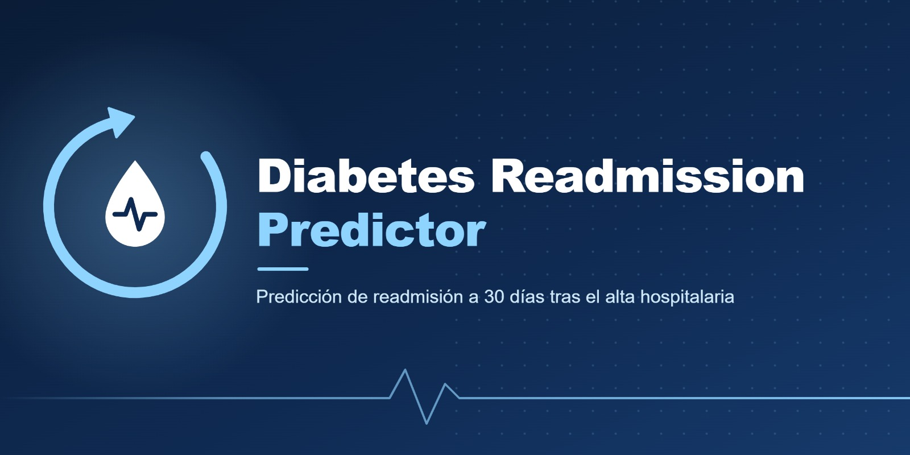

# Diabetes Readmission Predictor

<p align="center"></p>

Predicción de reingreso hospitalario en menos de 30 días para pacientes diabéticos, con modelos interpretables (SHAP) sobre datos reales de 130 hospitales de EE.UU.

Predicción de reingreso hospitalario **en menos de 30 días** en pacientes diabéticos, usando el dataset de UCI "Diabetes 130-US Hospitals" (licencia CC BY 4.0).

## Autores

- Ivanna Álvarez - 2251805
- Martín Ariza - 2251516
- Juliana Rueda - 2251801

## Objetivo del proyecto

Predecir si un paciente diabético será readmitido en menos de 30 días tras su alta hospitalaria.

## Dataset

**Diabetes 130-US Hospitals for Years 1999-2008** (UCI Machine Learning Repository): más de 100.000 encuentros hospitalarios de pacientes diabéticos en 130 hospitales de EE. UU., con variables demográficas, clínicas y de medicación.

Descarga: <https://archive.ics.uci.edu/dataset/296/diabetes+130-us+hospitals+for+years+1999-2008>

## Modelos utilizados

**Clasificación**

- Gaussian Naive Bayes (GNB)
- Decision Tree (DT)
- Random Forest (RF)
- Support Vector Machine (SVM)

**Regresión**

- Decision Tree Regressor
- Random Forest Regressor
- SVR

**Métricas**

- Recall, precision, F1
- MSE, MAE, RMSE

**Criterio de selección**

- Clasificación: F1 de la clase `<30` (desempate por recall)
- Regresión: menor RMSE

## Enlaces destacados

- Código: [notebooks](https://github.com/mzc07/diabetes-readmission-predictor/tree/develop/notebooks)
- Repositorio: [mzc07/diabetes-readmission-predictor](https://github.com/mzc07/diabetes-readmission-predictor/tree/develop)
- Video: INSERTAR LINK DE YUTU
- Diapositivas: INSERTAR LINK DE CANVA OSIOSI

---


## Notebooks

1. `01_eda.ipynb`: análisis exploratorio
2. `02_preprocesamiento.ipynb`: limpieza, features, split sin fuga, escalado y selección
3. `03_modelado.ipynb`: clasificación y regresión
4. `04_evaluacion.ipynb`: métricas, gráficas y selección del mejor modelo

## Estructura

| Ruta               | Contenido                                  |
| ------------------ | ------------------------------------------ |
| `data/raw/`        | Datos originales (no versionado)           |
| `data/processed/`  | Train/test procesados                      |
| `notebooks/`       | Notebooks del análisis                     |
| `src/`             | Código: data, features, models, evaluation |
| `tests/`           | Pruebas                                    |
| `artifacts/`       | Modelos y resultados generados             |
| `reports/figures/` | Gráficas                                   |
| `docs/assets/`     | Banner y diapositivas                      |
| `video/`           | Video del proyecto                         |

## Tests y calidad

```bash
uv run pytest
uv run ruff check . && uv run ruff format --check .
```

## Uso del Proyecto
- Usar este proyecto solo para fines educativos, no se recomienda su uso en casos médicos reales.
